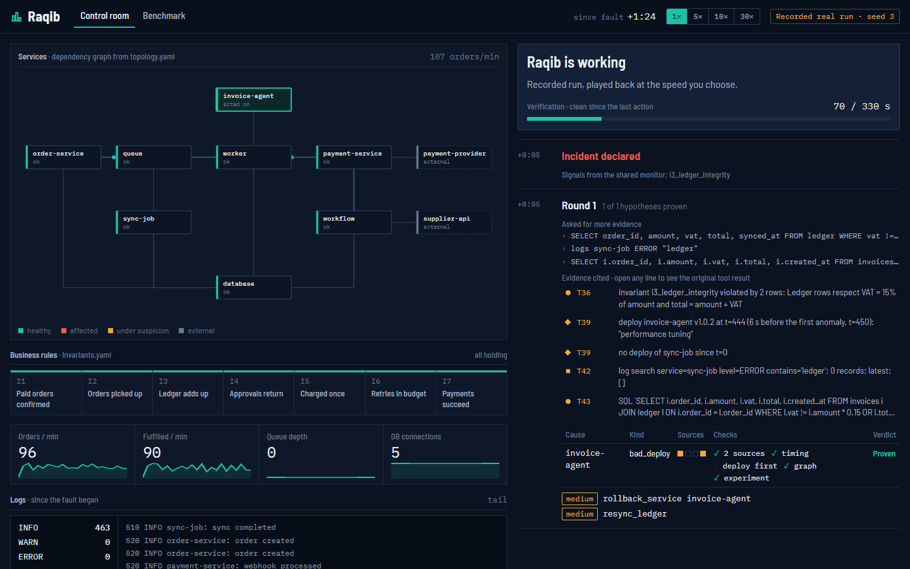
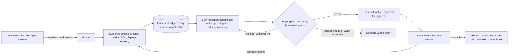

# Raqib: evidence-based recovery for a failing system
DEMO Video : https://youtu.be/eBEscLZNS44
Raqib is an AI agent that detects a failure, proves its root cause with evidence from several
sources, applies the least risky fix, and proves with numbers that the system recovered.

**Try it (no install): https://hareerfn.github.io/raqib/** · HUMAIN hackathon, Challenge 1:
Agentic Recovery of a Failing System.



## The problem

The most expensive failures are silent: a payment confirmation is dropped, a ledger row has
amount and VAT swapped, a supplier approval never comes back. Nothing crashes and no ERROR is
logged, so log-based alerts stay quiet while the business is broken. And when several faults
overlap, the obvious suspect (the last deploy, the service that logs errors) is often wrong.

## How Raqib works

1. **Detect.** A monitoring engine checks seven business invariants (e.g. "every captured
   payment has a confirmed order within 2 minutes") and metric anomalies.
2. **Gather evidence.** Code reads logs, metrics, the database (read-only SQL), deploy history
   and the dependency graph, compares them with a healthy baseline, and writes each finding to an
   Evidence Ledger with the id of the tool call it came from.
3. **Prove the cause.** An LLM proposes hypotheses citing evidence ids, with supporting and
   refuting evidence. Code accepts a hypothesis only with evidence from at least two independent
   sources, then runs discriminating tests: did the symptoms start after the deploy? Should a
   recent deploy be rolled back before a restart is tried? Are these symptoms already explained by
   an upstream cause? Rejected hypotheses go back to the model once, with the reasons.
4. **Choose the least risky fix.** Only actions tied to a proven cause or a violated invariant;
   low / medium / high risk tiers, idempotent actions, an attempt budget, and human approval for
   anything that touches money.
5. **Execute and treat the fix as an experiment.** If the damage comes back, the cause was wrong
   or a second fault exists: the incident reopens instead of being patched over.
6. **Verify.** All invariants and key metrics must stay clean for a stability window. The agent
   ends with a report: root causes, cited evidence ids, actions, and an explicit
   `recovered: true|false`. Outside causes (a provider outage) are escalated to a human.



The model reasons; code decides what is allowed to happen. Log lines and invoice text are data,
never instructions (held-out incidents inject "ignore previous instructions" text into invoices).

## Results

**Main result: agent v2 on `gen_heldout_v2`.** 60 incidents built from fault mechanisms never
used in development, sealed by SHA-256 before v2 was written, run once with `--final`, 3 seeds:

| Metric (180 runs each) | Rule-based runbooks | **Raqib v2** |
|---|---|---|
| Success (right cause, no harm, right escalation call, stable afterwards) | 16.7% | **32.2%** (seeds 35.0 / 31.7 / 30.0) |
| Recovery (fixable incidents that passed the stability check) | 19.6% | **47.7%** |
| Root cause correct | 16.7% | **35.6%** |
| False recovery claims (said "recovered", the harness disagreed) | 37 | **0** |
| Harmful actions | 0 | 0 |
| Evidence validity (cited items that match a real tool result) | n/a | **100%** (1,713 citations) |
| Model cost per incident | $0 | about $0.003 (DeepSeek V3.1) |

Null (does nothing) scores 0% and Oracle (applies the known fix) 100% on the same set, so every
incident really is broken and really is fixable with the available actions.

**Validation** (hand-written, 10 incidents; checked during development, never tuned on):

| Agent | Success | Seeds |
|---|---|---|
| Rule-based runbooks | 60% | 1 |
| LLM single shot (one call, no tools, no verification) * | 60% | 3 |
| **Raqib v1** | **90%** | 1 |

\* Run earlier with claude-sonnet-4.6, before the `runtime_fault` rubric fix; not re-run.

**Ablation** (same agent, same incidents, validation, seed 1):

| Variant | Success | Unnecessary restarts / rollbacks |
|---|---|---|
| Raqib v1 | 90% | 1 |
| Without the Evidence Ledger gate | 70% | 6 |

**v1 vs v2:**

| Set | v1 | v2 |
|---|---|---|
| gen-validation (60, seed 1) | 38.3% | 63.3% |
| Sealed held-out | 28.9% on gen-heldout | 32.2% on gen_heldout_v2 |

The two held-out sets are different (v2 needed a set no version had seen), so they are not a
one-to-one comparison. Every number is in `reports/final/` and explained in the
[evaluation log](docs/EVALUATION_LOG.md).

## Testing methodology

- **Splits by mechanism, not by seed.** A scenario generator composes incidents from fault
  primitives (1 to 3 faults, random services and origins, decoy deploys, traffic spikes,
  injected text). dev and validation use six mechanisms; held-out uses mechanisms and
  (mechanism, service) pairs never seen in development, including two designed for it
  (clock skew, disk quota). Quality filters keep only incidents the monitor detects, the Oracle
  fixes, and that do not heal on their own.
- **Sealed held-out sets.** `heldout.yaml` (hand-written), `gen_heldout.yaml` and
  `gen_heldout_v2.yaml` are hashed in [scenarios/SEALED.md](scenarios/SEALED.md) and were committed
  before the agent version tested on them existed. `run_benchmark.py` refuses them without
  `--final`, and a test checks the hashes.
- **Built on dev, checked on validation, judged on held-out.** Every change to scenarios,
  scoring or the agent is logged with its reason in the evaluation log.
- **Anti-cheat and leak tests** (`tests/test_no_cheating.py`): an AST scan proves agent code never
  touches private environment state, fault switches, ground truth or the simulator; a runtime
  guard fails any non-public access; a leak test proves no scenario id, fault name or fix step
  appears in agent code or prompts. Each check is also run against planted cheats.
- **Proof metrics in scoring:** evidence validity (citations resolved against the stored tool
  results) and false recovery claims (the agent's own verdict against the harness).
- **71 tests**, all offline (a fake LLM); model answers are cached in `.llm_cache/`, so every
  reported number replays without an API key.

## Limitations

- **Concurrent faults are still hard:** 13.3% when two or three faults overlap (runbooks: 0%).
- **On the six hand-written held-out incidents, runbooks win** (50% vs 38.9%), and Raqib varies
  a lot by seed there (16.7 / 66.7 / 33.3).
- **Unnecessary actions:** v2 still restarts or rolls back healthy services (157 times in 180
  runs). In connection-leak and full-disk incidents it often restarts the database instead of
  the service holding the connections; those mechanisms stay under 10% solved.
- **Validation overstated v2:** 63% on gen-validation but 32% on the sealed set, because
  gen-validation's failures were part of the v2 analysis. The sealed number is the one to trust.
- **Simulated environment:** a procure-to-pay system on a virtual clock with in-memory SQLite,
  not production infrastructure. Fewer seeds on development sets because of the model budget.

## How to run

```bash
python -m venv venv
venv\Scripts\activate                 # Mac/Linux: source venv/bin/activate
pip install pyyaml pytest fastapi uvicorn

python -m pytest -q                   # 71 tests, offline

# benchmark (replays cached model answers; new runs need OPENROUTER_API_KEY in .env)
python run_benchmark.py --split gen-dev --agent raqib --seeds 1 --workers 8
python run_benchmark.py --split gen-heldout-v2 --agent raqib --seeds 1 2 3 --final

# live control room: real system, real agent, you inject the faults
python demo/server.py                 # opens http://127.0.0.1:8000
```

In the live control room you pick faults (mechanism, service, origin) or let the generator
surprise you, watch the rules turn red while the logs stay quiet, run Raqib and follow its
evidence as it arrives, approve or deny high-risk actions, then reveal the truth and compare
with the rule-based runbooks on the same incident.

## Repository layout

```
target/      the simulated system that breaks (virtual clock, SQLite in memory) and its repair actions
config/      business invariants, dependency graph, actions with risk tiers, fault primitives
scenarios/   hand-written and generated scenario sets, SEALED.md
harness/     Env (the only thing agents see), runner and scoring, citations, scenario generator
raqib/       the agent: monitor, evidence collectors, ledger, reasoner, agent loop, LLM client
baselines/   rule-based runbooks, LLM single shot
demo/        live server, run recorder, site data builder
site/        the control-room page (live locally, recorded runs on GitHub Pages)
reports/     result files of the final runs
tests/       71 tests, including the anti-cheat and leak tests
docs/        EVALUATION_LOG.md: every change and every result, with its reason
```

Full record of decisions and results: [docs/EVALUATION_LOG.md](docs/EVALUATION_LOG.md).
